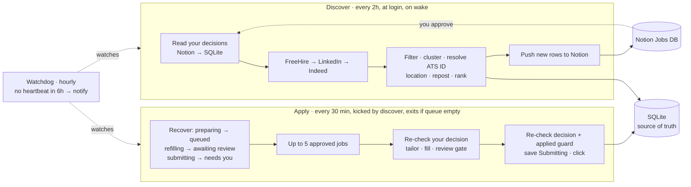
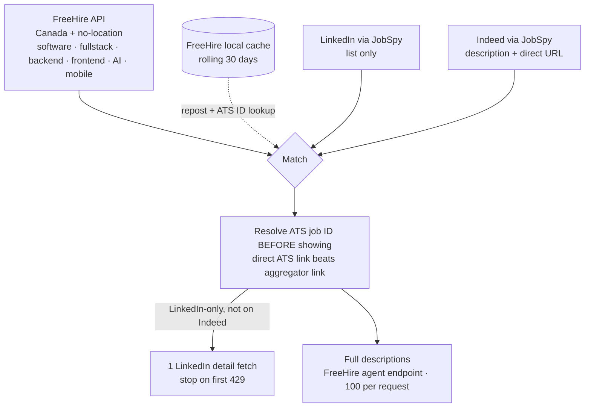
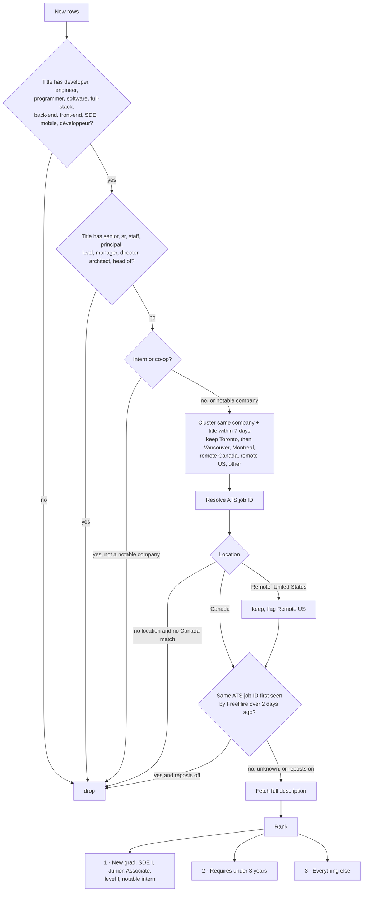
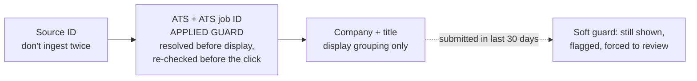
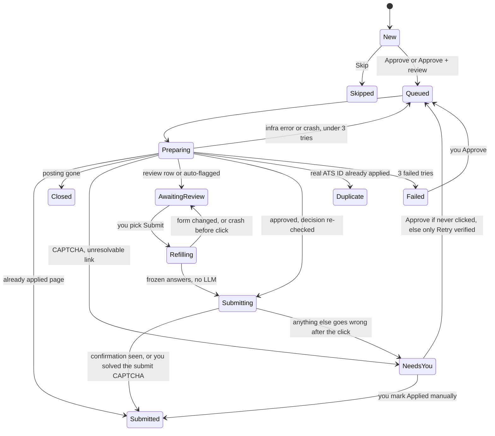
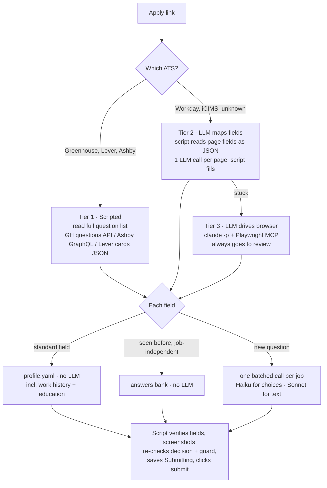
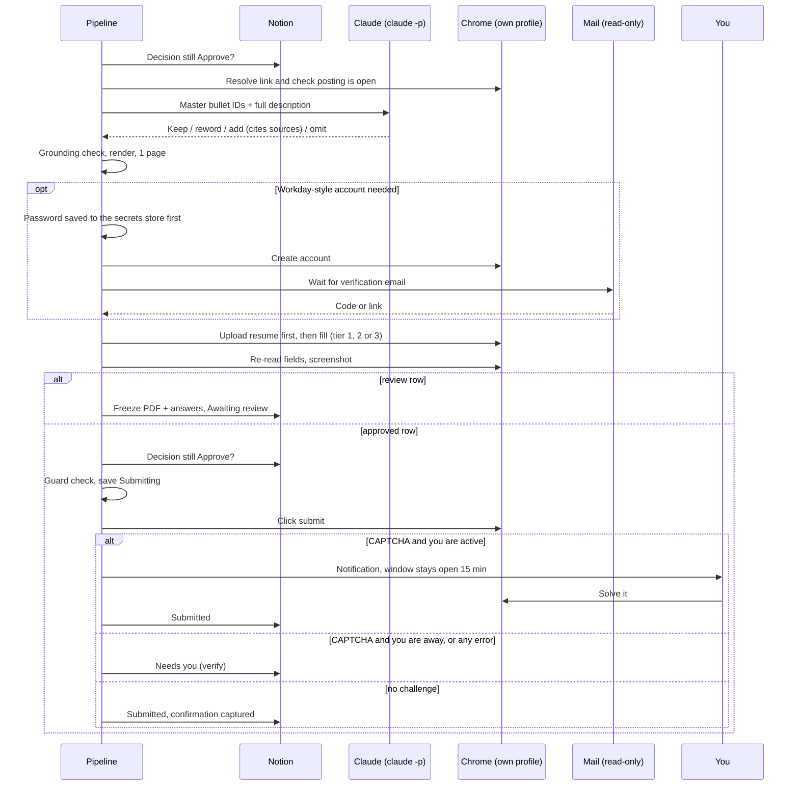
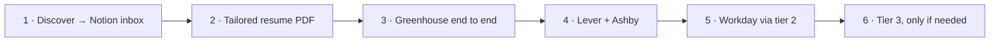

# JobApplier — Architecture (visual)

Draft v6 · 2026-10-31 · Full written spec: [`superpowers/specs/2026-10-31-job-applier-design.md`](superpowers/specs/2026-10-31-job-applier-design.md) (the spec wins if anything here disagrees; its §18 simplifications — one LaunchAgent, fewer states, no backfill — are not yet redrawn here)

A background job on your Mac finds fresh Canadian software postings every 2 hours, de-duplicates and ranks them into Notion, and applies to the ones you approve. Scraping is plain code. Forms are scripted for Greenhouse, Lever and Ashby, and LLM-assisted for Workday and everything else. Claude tailors the resume and writes free-text answers, and usage is tracked in Notion against one daily cap.

---

## 1. Three background jobs

| | |
|---|---|
| **SQLite is the source of truth** | Notion is the screen. A Notion glitch can't cause a double application |
| **Separate apply job** | A slow application session never blocks discovery |
| **Watchdog** | A tiny shell script with no Python, so it still alerts you if the main setup breaks |

---

## 2. Where jobs come from

- **Priority FreeHire › LinkedIn › Indeed** for descriptions and details. The **apply link** is chosen separately: a direct Greenhouse/Workday/… link always wins over a whatjobs-style redirect link.
- **Budgets:** FreeHire allows 2,000 requests a day. Matching uses the local cache rather than one call per job.

---

## 3. Filtering, clustering, ranking (in this order)

- A company + title match without a matching job ID counts as **Repost unknown** and is kept, so a genuinely new posting at a company that reposts the same title weekly isn't lost.
- **French postings are kept.** The resume stays in English; answers are written in the question's language.
- After downtime, the first-seen window stretches to cover the gap, up to 3 days. Jobs picked up late get a **Late** flag.

---

## 4. Keys, so nothing is applied twice

---

## 5. What you see in Notion

**Decision** (you): New · Approve · Approve + review · Skip · Submit · Retry (verified) · Applied manually
**Inbox** shows New, Queued, Awaiting review, Needs you and Failed. **History** shows everything. Nothing is deleted.

| Decision | Status | Rank | Title | Company | City | ATS · Tier | Flags | LLM usage |
|---|---|---|---|---|---|---|---|---|
| Approve | ✅ Submitted | 1 | Associate Software Engineer | BlackLine | Toronto | Workday · 2 | – | $0.21 |
| Approve + review | 🟡 Awaiting review | 2 | Software Engineer II, Full Stack | Affirm | Toronto | Greenhouse · 1 | – | $0.08 |
| New | 🔴 Needs you | 2 | Software Engineer, Identity | Lyft | Toronto | Greenhouse · 1 | – | $0.06 |
| New | ⚪ New | 1 | Software Developer Embedded Systems I | Cisco | Kanata | – | Repost unknown | – |

*Example rows with made-up values, to show the shape.* "Needs you" resets Decision to New, so re-approving is a visible change. Each row's page has the final resume PDF, answers, and a screenshot.

**Pipeline status page:** last runs · errors · LinkedIn blocks · FreeHire/Notion requests · mail login state · **LLM usage today and last 7 days by model and purpose · daily cap**.

---

## 6. Life of one job

- **Point of no return:** *Submitting* is saved before the click and never retried automatically. If something goes wrong after the click, plain Approve is refused. Only **Retry (verified)** works, and only after the pipeline has posted its confirmation-email search result in the row.
- **CAPTCHAs at submit time are common** (Lever, Greenhouse). If you're at the Mac, the window stays open for up to 15 minutes so you can solve it.
- **Your decision is re-read from Notion** right before tailoring and right before submitting, so if you switch a job to Skip mid-run, it isn't sent.
- **Switched to review automatically when:**
  - a sensitive question has no set answer in your profile
  - tier 3 was used
  - a required field couldn't be filled
  - a new question type specific to this job comes up
  - a resume change failed the grounding check
  - you applied to a similar role in the last 30 days

---

## 7. Filling the form: three tiers

- **The LLM never clicks submit.** The script does, after its checks.
- Custom questions are fine: tier 1 reads the company's full question list first, so nothing on the form is unexpected. This was checked against live Greenhouse, Ashby and Lever jobs.
- Your work history and education are generated once from `master.tex` into `profile.yaml` for you to check. Workday's "My Experience" page needs them.
- Answers like "Why this company?" are never reused across companies.
- An **added resume bullet** may only expand or split **one** master bullet, never combine several.

---

## 8. Applying to one job

---

## 9. Models and usage

| Job | Model |
|---|---|
| Resume tailoring (reword, add, omit; grounded in master bullets) | Sonnet 5.5 |
| Free-text answers | Sonnet 5.5 · Opus medium for hard ones |
| Choice fields, tier 2 field mapping, unclear seniority | Haiku (confirm ID after upgrade) |
| Tier 3 browser driving | Sonnet 5.5 |

**Writing style:** every bullet and answer follows **Humanizer** (no AI-sounding phrasing) and **ASD-STE100** writing rules (short sentences, active voice, one idea per sentence). Both are real Claude Code skills stored in the repo (`.claude/skills/`). Writing calls load them in `claude -p` with only the Skill tool allowed. A quick code check catches long sentences and banned phrases; on failure it retries once, then the row goes to review.

At most 4 jobs start LLM work per hour (adjustable), so the pipeline doesn't use up your plan's 5-hour window in one burst. Every call records its tokens and **equivalent cost** (`total_cost_usd`). That figure isn't billed on your subscription but works as a usage gauge. There's **one overall daily cap**; once it's hit, remaining jobs wait until the next day.

---

## 10. Runtime and security

| | |
|---|---|
| **Locks** | Python `fcntl.flock` + PID. A crashed run can't block later runs |
| **Paths** | launchd has a bare PATH, so the scripts use full paths to `uv`, `claude` and `tectonic` |
| **Secrets** | `.env` (git-ignored): Notion token, mail token. A password per Workday-style account is saved to a secure store before the account is created (store not chosen yet) |
| **Least access** | Notion sees one database · mail is read-only · writing calls: Skill tool only · classification calls: no tools · tier 3: browser only · no ports opened |
| **Chrome** | Dedicated profile. Opens without taking focus where possible. The automation banner is left alone (no evasion) |

**Day-one checks:** school mailbox allows app access (otherwise switch to Gmail before creating any accounts) · `claude -p` from launchd (login, usage-limit error, cost field) · notifications · FreeHire backfill budget · LinkedIn blocking rate · Chrome focus and CAPTCHA rate · tectonic cache.

---

## 11. How it gets built (simplicity first)

Python 3.12 with standard-library `sqlite3` and dataclasses, and a few packages (JobSpy, requests, Playwright, PyYAML, msal). No ORM, no web framework, no task queue. Two small interfaces, **Source** and **ATS adapter**, plus a state machine in one module. Everything else is plain functions. Tests come first for the core logic, using today's spike data.

Each slice is usable on its own. Slice 1 already gives you the daily ranked inbox.
